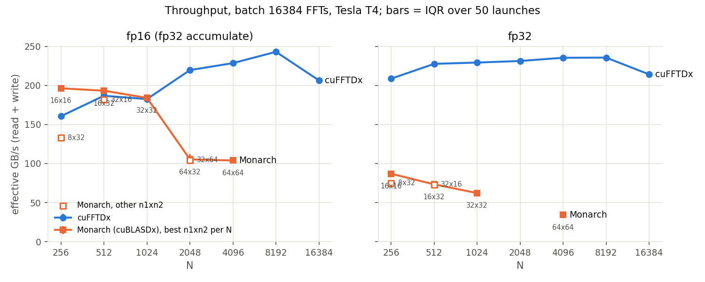
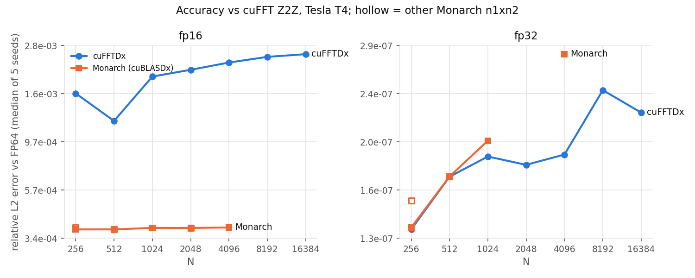

# DxBench: Monarch FFT on cuBLASDx vs cuFFTDx

For batched 1D complex FFTs computed inside one CUDA block, when does a
four-step / Monarch factorization N = n1·n2, run as two small GEMMs with
cuBLASDx on tensor cores, beat a radix FFT from cuFFTDx, and what does it cost
in accuracy?

I measured this on one GPU, a Tesla T4 (sm_75), with MathDx 26.10
(cuFFTDx 1.8.0, cuBLASDx 0.8.0) and CUDA 13.0.

## Findings

All numbers are from one sweep, `results/tesla_t4/2026-11-17_sweep.jsonl`, at a batch of 16384 FFTs.
The full tables and method are in [docs/results.md](docs/results.md).




- **fp16 operands with fp32 accumulation:** Monarch is faster than cuFFTDx fp16
  at N = 256 (1.19×) and N = 512 (1.03×), and slower from N = 1024 on
  (0.90× at 1024, 0.39× at 4096).
- **fp16 accuracy:** Monarch's relative L2 error against FP64 is 3.7–3.8e-4 at
  every N. cuFFTDx fp16 is 1.2e-3 to 2.5e-3 and grows with N, so Monarch is
  3.3× to 6.0× more accurate.
- **fp32:** the T4 has no fp32 tensor cores, so Monarch's GEMMs run on FFMA. It
  reaches 0.14–0.41× of cuFFTDx's throughput at about the same accuracy.
- **Tensor cores, shown in SASS:** every fp16 Monarch kernel contains HMMA
  instructions. The fp32 kernels and every cuFFTDx kernel contain none (the
  table is in docs/results.md).
- **Why Monarch slows down at large N (Nsight Compute, fp16 64×64):**
  - shared memory (48 KB per block) allows one 128-thread block per SM, so
    4 warps of 32 are active;
  - it executes 2.8× cuFFTDx's instructions;
  - shared-memory traffic is about 4.5× cuFFTDx's, with many bank conflicts.

  cuFFTDx is at 85 % of peak memory throughput and Monarch at 38 %, for the
  same DRAM bytes.

One result I did not expect: with cuBLASDx's default shared-memory layouts the
fp16 GEMMs compile to scalar HMUL2/FADD on sm_75, not HMMA. Only the
`suggest_layout_smem_*` / `suggest_accumulator` path reaches tensor cores, and
only when the GEMM shape divides the 32×16×8 warp tile. Shapes like M = 16
silently fall back to scalar code. `cuda/monarch/mma_probe.cu` isolates this,
and `docs/decisions.md` traces it through the headers.

## Layout

```
reference/     NumPy FP64 reference and Monarch reference, pytest in tests/
cuda/common/   timing, FP64 cuFFT reference, error metrics, JSON-lines provenance
cuda/cufftdx/  baseline block FFT (follows NVIDIA's cuFFTDx examples)
cuda/monarch/  Monarch FFT with cuBLASDx, plus the HMMA probe
scripts/       env_check.sh, sass_check.sh, sweep.py, plot.py
gpu/           runner notebook for Colab / Kaggle
results/       raw measurements, never edited
docs/          derivation, decisions log, results, agent log
```

## How to run

You need an NVIDIA GPU. I used a Colab T4.

1. Open `gpu/runner.ipynb` in Colab with a GPU runtime and run all cells. It
   clones the repo, downloads MathDx, builds, runs `ctest`, the sweep and the SASS
   check, and downloads the sweep file.
2. Or by hand:

```
cmake -S . -B build -DCUDA_ARCH=75 -DMATHDX_ROOT=/path/to/nvidia/mathdx/26.10
cmake --build build -j
ctest --test-dir build --output-on-failure
python3 scripts/sweep.py                 # writes results/<gpu>/<date>_sweep.jsonl
python3 scripts/plot.py --tables         # figures into docs/figures/<gpu>/
```

The Python reference and its tests run without a GPU:
`pip install -r requirements.txt && python3 -m pytest -q`.

## Limitations

- **One GPU:** T4 only, so nothing here covers Ampere or Hopper tensor cores.
- **Partial profiling:** four fp16 kernels were profiled, and no optimization has
  been tested against those profiles yet.
- **Unpinned clocks:** Colab sessions vary by up to about 13 %. Figures use one
  session only.
- **Limited sizes:** Monarch covers N ≤ 4096 with power-of-two two-factor splits.
  fp32 N = 2048 does not fit in shared memory.
- **No fusion yet:** the reason to have a block-level FFT is fusing it with other
  work, and I have not measured that case.

## Prior work

- **The Monarch decomposition on tensor cores** is from FlashFFTConv
  (Fu et al., ICLR 2024).
- **Half-precision tensor-core FFTs:** tcFFT (Li, Cheng, Lin, 2021,
  arXiv:2104.11471) and the split fp32 → 2× fp16 line of work (SC18 poster and
  follow-ups) did this before.
- **The baseline** follows NVIDIA's MathDx examples.

What this repo adds is narrow:
- a block-level Monarch FFT built from MathDx pieces;
- a head-to-head comparison against cuFFTDx rather than cuFFT, with the error
  measured against FP64 on the same inputs;
- a record of which cuBLASDx configurations reach HMMA on sm_75.

## How this was built

I implemented it with Claude Code as the main coding tool, working phase by
phase from a written spec (CLAUDE.md). I defined the research question and the
scope, ran every experiment on a GPU, and reviewed the results. Design
decisions and failed attempts are logged in docs/decisions.md.

What the agent struggled with in practice was the MathDx API: which instruction
cuBLASDx actually selects. Twice it assumed the fp16 GEMMs would use tensor
cores, and twice they did not. Both times the correctness tests passed, and only
the SASS check caught it. docs/agent_log.md lists these mistakes. They motivate
the planned next part: an MCP server with whitelisted compile, validate and
profile tools, and an evaluation of whether it helps an agent write correct
MathDx code.
