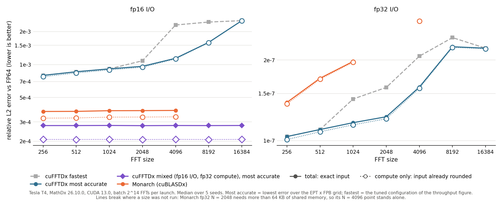
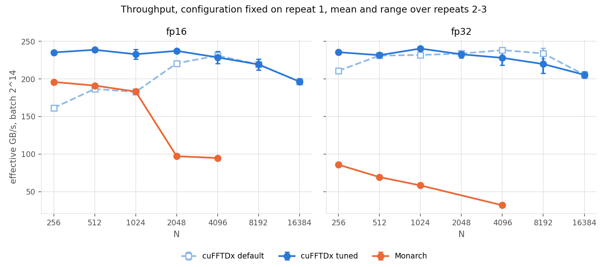

# DxBench: Monarch FFT on cuBLASDx vs cuFFTDx

For batched 1D complex FFTs computed inside one CUDA block, when does a
four-step / Monarch factorization N = n1·n2, run as two small GEMMs with
cuBLASDx on tensor cores, beat a radix FFT from cuFFTDx, and what does it cost
in accuracy?

I measured this on one GPU, a Tesla T4 (sm_75), with MathDx 26.10
(cuFFTDx 1.8.0, cuBLASDx 0.8.0) and CUDA 13.0.

## Findings

From three repeats of one sweep in one Colab session (`results/tesla_t4/2026-11-18_sweep_{3,4,5}.jsonl`), batch
16384. Configurations are chosen on repeat 1 and measured on repeats 2-3. The tables, the method and the
interpretations are in [docs/results.md](docs/results.md).




- **fp16 accuracy is the result that holds.** Monarch's relative L2 error against FP64 is 3.7-3.8e-4 at every N
  from 256 to 4096. The most accurate cuFFTDx fp16 configuration in a full EPT × FPB grid has 2.1× (N = 256) to
  3.0× (N = 4096) more error. Against the error of the transform alone (input already rounded to fp16), the gap
  grows to 2.4-3.4×, so it is not an input-quantization effect.
- **Mechanism, from SASS.** cuFFTDx's fp16 butterflies run in HFMA2, so every stage rounds to fp16. Monarch's GEMMs
  run on HMMA with fp32 accumulation and round to fp16 at about three points. Fewer roundings and a flat error
  in N fit this; it is a reading, not a proof.
- **Speed: tuned cuFFTDx is faster everywhere.** Monarch fp16 reaches 0.83× (N = 256), 0.80× (512), 0.79× (1024)
  and 0.41× (2048, 4096) of tuned cuFFTDx, with no range over the repeats near 1.0. Against cuFFTDx's default
  configuration, it was 1.21× faster at N = 256. That earlier speed result depended on the default: EPT 2 makes
  cuFFTDx fp16 1.46× faster at N = 256.
- **fp32:** the T4 has no fp32 tensor cores, so Monarch's GEMMs run on FFMA. It reaches 0.14-0.36× of tuned
  cuFFTDx's throughput, with 1.3-1.8× its best error.
- **Tensor cores, in SASS and ncu:** every fp16 Monarch kernel contains HMMA, and the tensor pipe is active
  19-33 % at runtime. The fp32 Monarch kernels and the cuFFTDx kernels contain none.
- **Why Monarch slows down at large N (Nsight Compute, fp16 64×64, earlier session):** it is not memory-bound
  (47 % of peak memory throughput vs 85 % for cuFFTDx). It executes 2.8× the instructions and about 4.5× the
  shared-memory wavefronts, with heavy bank conflicts.

- **Agent eval: floor effect.** Qwen3 8B solved 0 of 8 held-out MathDx tasks alone, with the docs, and with docs
  plus the MCP compile/test/SASS loop. It invents headers and host-style APIs that cuFFTDx and cuBLASDx do not
  have. The one correct answer called host cuFFT and was rejected by the library check. Per-task table:
  [eval/README.md](eval/README.md).

Observed behavior on sm_75 that I did not expect: with cuBLASDx's plain shared-memory layouts, a complex fp16
GEMM with fp32 accumulation compiles to FMA, not HMMA. Only the `suggest_layout_smem_*` / `suggest_accumulator`
path reaches tensor cores, and only when the shape divides the 32×16×8 warp tile.
[docs/cublasdx_sm75_layouts.md](docs/cublasdx_sm75_layouts.md) has the repro, the instruction counts and the
header lines involved.

## Layout

```
reference/     NumPy FP64 reference and Monarch reference, pytest in tests/
cuda/common/   timing, FP64 cuFFT reference, error metrics, JSON-lines provenance
cuda/cufftdx/  baseline block FFT (follows NVIDIA's cuFFTDx examples)
cuda/monarch/  Monarch FFT with cuBLASDx, plus the HMMA probe
scripts/       env_check.sh, sass_check.sh, sweep.py, plot.py, final.py
gpu/           runner notebook for Colab / Kaggle
results/       raw measurements, never edited
docs/          derivation, decisions log, results, agent log
```

## How to run

You need an NVIDIA GPU. I used a Colab T4.

1. Open `gpu/runner.ipynb` in Colab with a GPU runtime and run all cells. It
   clones the repo, downloads MathDx, builds, runs `ctest`, the sweep and the SASS
   check, and downloads the sweep file.
2. Or by hand:

```
cmake -S . -B build -DCUDA_ARCH=75 -DMATHDX_ROOT=/path/to/nvidia/mathdx/26.10
cmake --build build -j
ctest --test-dir build --output-on-failure
cmake --build build --target cufftdx_grid -- -k   # cuFFTDx EPT x FPB grid, one binary per N
python3 scripts/sweep.py --grid --repeat 3        # three files results/<gpu>/<date>_sweep_<k>.jsonl
python3 scripts/final.py <sweep 1> <sweep 2> <sweep 3> --figures docs/figures/<gpu>
```

The Python reference and its tests run without a GPU:
`pip install -r requirements.txt && python3 -m pytest -q`.

## Limitations

- **One GPU and one session.** T4 only, so nothing here covers Ampere or Hopper tensor cores. The final numbers are
  three repeats in one Colab session with unlocked clocks; they bound noise within the session, not across
  sessions.
- **Tuning differs in kind.** cuFFTDx gets the full grid of its two exposed knobs. Monarch gets its factorization,
  plus structural choices I made by hand (persistent grid, shared F table, transposed GEMM 1).
- **Partial profiling.** Four fp16 kernels from an earlier session were profiled; the tuned cuFFTDx
  configurations were not.
- **Limited sizes.** Monarch covers N ≤ 4096 with power-of-two two-factor splits. fp32 N = 2048 does not fit in
  shared memory.
- **Agent eval is one small model, one run per cell.** 8 held-out tasks (h09 and h10 were not written), Qwen3 8B
  at temperature 0, which solved none in any condition. Condition C also gets a longer prompt (more tool
  descriptions). The dev task d3 does not enforce fp16 inside the kernel.
- **No fusion yet.** The reason to have a block-level FFT is fusing it with other work, and I have not measured
  that case.

## Prior work

- **The Monarch decomposition on tensor cores** is from FlashFFTConv
  (Fu et al., ICLR 2024).
- **Half-precision tensor-core FFTs:** tcFFT (Li, Cheng, Lin, 2021,
  arXiv:2104.11471) and the split fp32 → 2× fp16 line of work (SC18 poster and
  follow-ups) did this before.
- **The baseline** follows NVIDIA's MathDx examples.

What this repo adds is narrow:
- a block-level Monarch FFT built from MathDx pieces;
- a head-to-head comparison against cuFFTDx rather than cuFFT, with the error
  measured against FP64 on the same inputs;
- a record of which cuBLASDx configurations reach HMMA on sm_75.

## How this was built

I implemented it with Claude Code as the main coding tool, working phase by
phase from a written spec (CLAUDE.md). I defined the research question and the
scope, ran every experiment on a GPU, and reviewed the results. Design
decisions and failed attempts are logged in docs/decisions.md.

What the agent struggled with in practice was the MathDx API: which instruction
cuBLASDx actually selects. Twice it assumed the fp16 GEMMs would use tensor
cores, and twice they did not. Both times the correctness tests passed, and only
the SASS check caught it. docs/agent_log.md lists these mistakes. They motivated
the second part: an MCP server (mcp/) with whitelisted compile, test, SASS and
diagnose tools, and an evaluation (eval/) of whether docs and that loop help a
local model write MathDx code. With Qwen3 8B the answer is a floor effect, not
a yes or no.
