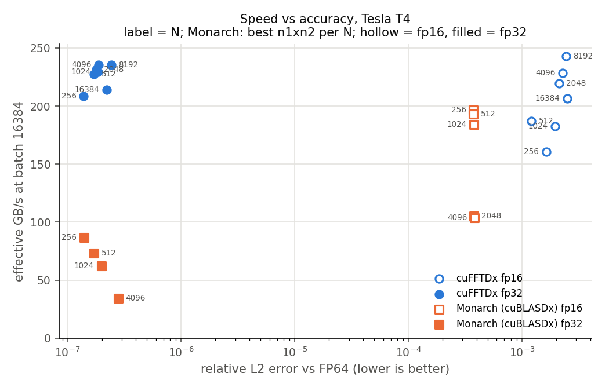

# Results: Monarch FFT on cuBLASDx vs cuFFTDx, Tesla T4

Every number below comes from one sweep file, named at the top of each
table, produced by `scripts/sweep.py` and turned into tables and figures by
`scripts/plot.py --tables`. Statements tagged *(interpretation)* are my
reading of the numbers, not measurements.

Sweep file: `results/tesla_t4/2026-11-17_sweep_3.jsonl` (commit 38e465c, one Colab session, tables printed by `python3 scripts/plot.py --tables`). Earlier sweeps of older kernel versions are kept in `results/tesla_t4/`; docs/decisions.md says what changed between them.

## Question

For batched 1D complex FFTs computed inside one CUDA block, when does a
four-step / Monarch factorization N = n1·n2, run as two small cuBLASDx GEMMs
on tensor cores, beat cuFFTDx's radix FFT, and what does it cost in accuracy?

## Method

- **Hardware and software.** Tesla T4 (sm_75, 40 SMs) on Google Colab.
  The sweep file records the driver, CUDA, cuFFT, MathDx (26.10.0: cuFFTDx 1.8.0,
  cuBLASDx 0.8.0) and git commit on every line.
- **Transform.** Forward C2C, X[k] = Σ x[n]·exp(-2πi·nk/N), no normalization,
  out of place. N from 256 up to the largest size each implementation fits in
  one block.
- **cuFFTDx baseline.** The `Block` FFT with the library's suggested
  elements per thread and FFTs per block, following NVIDIA's examples
  (`cuda/cufftdx/block_fft.cu`). fp16 uses cuFFTDx's implicit batching
  (two FFTs per `__half2`).
- **Monarch** (`cuda/monarch/monarch_fft.cu`, derivation in `docs/derivation.md`):
  - GEMM 1 multiplies the reshaped input by F_n1.
  - Twiddles are applied in fp32 on the accumulator in registers.
  - GEMM 2 multiplies by F_n2.
  - The output is transposed through shared memory.
  - fp16 means fp16 operands with fp32 accumulation, using cuBLASDx's suggested
    shared-memory layouts (the path that emits HMMA on sm_75, see
    `docs/decisions.md`). fp32 runs on FFMA: there is no fp32 tensor-core
    instruction on sm_75.
  - 128 threads per block, max(1, 4096/N) FFTs per block, persistent grid.
- **Accuracy.**
  - Inputs ~ U(-1, 1) complex from a counter-based hash.
  - Reference: cuFFT Z2Z (FP64) on the unrounded input, so the error includes
    rounding the input to fp16/fp32.
  - Metrics: relative L2 error over 64 FFTs per seed, median over 5 seeds, and max abs error.
- **Timing.**
  - CUDA events around each launch: 5 warm-up launches, 50 timed launches, median and IQR.
  - Two batch sizes:
    - ~2^14 FFTs (throughput);
    - one block's group of FFTs on one block (latency, launch overhead included).
  - Effective GB/s = 2 · batch · N · sizeof(complex T) / time, i.e. one read and one write.
- **Tensor-core evidence.** `scripts/sass_check.sh` counts MMA, FFMA and
  HFMA2 opcodes per kernel in `cuobjdump -sass`. The counts are static: an
  unrolled-or-not K loop changes how often each one executes.

## Throughput

Batch 16384 FFTs. Monarch row = fastest factorization at that N.

| prec | N | cuFFTDx GB/s [IQR] | Monarch n1xn2 | Monarch GB/s [IQR] | Monarch / cuFFTDx | cuFFTDx rel L2 | Monarch rel L2 |
|---|---:|---:|---|---:|---:|---:|---:|
| fp16 | 256 | 160.6 [159.0, 163.9] | 16x16 | 196.4 [193.7, 198.1] | 1.22 | 1.64e-03 | 3.73e-04 |
| fp16 | 512 | 186.8 [186.2, 187.3] | 16x32 | 193.3 [192.2, 193.9] | 1.03 | 1.22e-03 | 3.74e-04 |
| fp16 | 1024 | 182.5 [182.0, 182.7] | 32x32 | 184.1 [181.7, 184.9] | 1.01 | 1.97e-03 | 3.79e-04 |
| fp16 | 2048 | 219.7 [219.0, 220.7] | 64x32 | 105.3 [104.5, 112.2] | 0.48 | 2.12e-03 | 3.80e-04 |
| fp16 | 4096 | 228.6 [226.6, 229.1] | 64x64 | 103.9 [101.8, 104.3] | 0.45 | 2.30e-03 | 3.81e-04 |
| fp16 | 8192 | 243.1 [242.5, 243.4] | - | - | - | 2.44e-03 | - |
| fp16 | 16384 | 206.5 [205.4, 207.7] | - | - | - | 2.51e-03 | - |
| fp32 | 256 | 208.7 [207.4, 210.0] | 16x16 | 86.9 [86.0, 87.2] | 0.42 | 1.38e-07 | 1.39e-07 |
| fp32 | 512 | 227.7 [227.3, 228.3] | 16x32 | 73.4 [72.5, 73.5] | 0.32 | 1.71e-07 | 1.71e-07 |
| fp32 | 1024 | 229.4 [228.8, 229.9] | 32x32 | 62.2 [61.8, 62.4] | 0.27 | 1.85e-07 | 1.98e-07 |
| fp32 | 2048 | 231.4 [230.8, 231.6] | - | - | - | 1.79e-07 | - |
| fp32 | 4096 | 235.5 [235.1, 235.7] | 64x64 | 34.2 [34.0, 34.4] | 0.15 | 1.87e-07 | 2.81e-07 |
| fp32 | 8192 | 235.7 [235.6, 235.8] | - | - | - | 2.43e-07 | - |
| fp32 | 16384 | 214.2 [213.7, 215.2] | - | - | - | 2.21e-07 | - |

Every Monarch configuration (batch 16384):

| prec | N | n1xn2 | FFTs/block | smem B | blocks/SM | GB/s | rel L2 | max abs |
|---|---:|---|---:|---:|---:|---:|---:|---:|
| fp16 | 256 | 8x32 | 16 | 20736 | 2 | 132.9 | 3.81e-04 | 1.87e-02 |
| fp16 | 256 | 16x16 | 16 | 17408 | 3 | 196.4 | 3.73e-04 | 2.09e-02 |
| fp16 | 512 | 16x32 | 8 | 21504 | 3 | 193.3 | 3.74e-04 | 2.96e-02 |
| fp16 | 512 | 32x16 | 8 | 21504 | 3 | 181.8 | 3.73e-04 | 2.76e-02 |
| fp16 | 1024 | 32x32 | 4 | 20480 | 3 | 184.1 | 3.79e-04 | 4.11e-02 |
| fp16 | 2048 | 32x64 | 2 | 36864 | 1 | 104.5 | 3.79e-04 | 6.18e-02 |
| fp16 | 2048 | 64x32 | 2 | 36864 | 1 | 105.3 | 3.80e-04 | 5.85e-02 |
| fp16 | 4096 | 64x64 | 1 | 32768 | 2 | 103.9 | 3.81e-04 | 9.20e-02 |
| fp32 | 256 | 8x32 | 16 | 41472 | 1 | 74.8 | 1.55e-07 | 1.19e-05 |
| fp32 | 256 | 16x16 | 16 | 34816 | 1 | 86.9 | 1.39e-07 | 9.18e-06 |
| fp32 | 512 | 16x32 | 8 | 43008 | 1 | 73.4 | 1.71e-07 | 1.93e-05 |
| fp32 | 512 | 32x16 | 8 | 43008 | 1 | 73.0 | 1.71e-07 | 1.46e-05 |
| fp32 | 1024 | 32x32 | 4 | 40960 | 1 | 62.2 | 1.98e-07 | 2.71e-05 |
| fp32 | 4096 | 64x64 | 1 | 65536 | 1 | 34.2 | 2.81e-07 | 8.52e-05 |
| fp32 | 2048 | 32x64 | 2 | 73728 | - | skipped: shared memory | | |
| fp32 | 2048 | 64x32 | 2 | 73728 | - | skipped: shared memory | | |

## Accuracy

Numbers: the rel L2 columns of the two tables above.

## Speed vs accuracy

## Latency (one block)

| prec | impl | N | n1xn2 | FFTs | median us [IQR] |
|---|---|---:|---|---:|---:|
| fp16 | cufftdx | 256 |  | 8 | 7.0 [6.6, 7.8] |
| fp16 | monarch | 256 | 8x32 | 16 | 14.0 [13.2, 14.3] |
| fp16 | monarch | 256 | 16x16 | 16 | 10.2 [9.9, 10.3] |
| fp16 | cufftdx | 512 |  | 4 | 6.1 [5.9, 6.2] |
| fp16 | monarch | 512 | 16x32 | 8 | 10.7 [10.4, 11.5] |
| fp16 | monarch | 512 | 32x16 | 8 | 13.1 [12.3, 14.0] |
| fp16 | cufftdx | 1024 |  | 2 | 6.4 [6.1, 7.0] |
| fp16 | monarch | 1024 | 32x32 | 4 | 11.9 [11.2, 12.3] |
| fp16 | cufftdx | 2048 |  | 2 | 7.1 [6.6, 7.7] |
| fp16 | monarch | 2048 | 32x64 | 2 | 14.7 [14.5, 15.4] |
| fp16 | monarch | 2048 | 64x32 | 2 | 15.1 [14.6, 16.1] |
| fp16 | cufftdx | 4096 |  | 2 | 9.2 [8.8, 9.8] |
| fp16 | monarch | 4096 | 64x64 | 1 | 14.3 [14.1, 14.5] |
| fp16 | cufftdx | 8192 |  | 2 | 14.4 [14.3, 15.0] |
| fp16 | cufftdx | 16384 |  | 2 | 24.6 [24.4, 24.6] |
| fp32 | cufftdx | 256 |  | 4 | 8.2 [7.9, 8.2] |
| fp32 | monarch | 256 | 8x32 | 16 | 31.1 [30.8, 31.9] |
| fp32 | monarch | 256 | 16x16 | 16 | 22.8 [22.6, 23.5] |
| fp32 | cufftdx | 512 |  | 2 | 8.2 [8.1, 8.5] |
| fp32 | monarch | 512 | 16x32 | 8 | 29.0 [28.7, 29.9] |
| fp32 | monarch | 512 | 32x16 | 8 | 29.8 [29.1, 30.3] |
| fp32 | cufftdx | 1024 |  | 1 | 9.1 [8.5, 9.5] |
| fp32 | monarch | 1024 | 32x32 | 4 | 36.0 [35.1, 36.4] |
| fp32 | cufftdx | 2048 |  | 1 | 8.3 [8.2, 8.8] |
| fp32 | cufftdx | 4096 |  | 1 | 9.6 [8.6, 10.1] |
| fp32 | monarch | 4096 | 64x64 | 1 | 66.4 [65.9, 67.0] |
| fp32 | cufftdx | 8192 |  | 1 | 15.1 [14.6, 15.6] |
| fp32 | cufftdx | 16384 |  | 1 | 24.7 [24.6, 25.9] |

The two implementations put different numbers of FFTs
in a block (cuFFTDx's suggestion vs 4096/N for Monarch), so this row compares
one launch of one block each, not equal work.

## Tensor-core evidence (SASS)

| impl | prec | N | n1xn2 | MMA | FFMA | HFMA2 | total |
|---|---|---:|---|---:|---:|---:|---:|
| cufftdx | fp16 | 256 |  | 0 | 0 | 84 | 720 |
| cufftdx | fp16 | 512 |  | 0 | 0 | 52 | 440 |
| cufftdx | fp16 | 1024 |  | 0 | 0 | 128 | 968 |
| cufftdx | fp16 | 2048 |  | 0 | 0 | 136 | 1016 |
| cufftdx | fp16 | 4096 |  | 0 | 0 | 148 | 1072 |
| cufftdx | fp16 | 8192 |  | 0 | 0 | 192 | 1296 |
| cufftdx | fp16 | 16384 |  | 0 | 0 | 192 | 1344 |
| cufftdx | fp32 | 256 |  | 0 | 96 | 0 | 592 |
| cufftdx | fp32 | 512 |  | 0 | 64 | 0 | 400 |
| cufftdx | fp32 | 1024 |  | 0 | 152 | 0 | 848 |
| cufftdx | fp32 | 2048 |  | 0 | 160 | 0 | 896 |
| cufftdx | fp32 | 4096 |  | 0 | 172 | 0 | 952 |
| cufftdx | fp32 | 8192 |  | 0 | 228 | 0 | 1184 |
| cufftdx | fp32 | 16384 |  | 0 | 228 | 0 | 1216 |
| monarch | fp16 | 256 | 8x32 | 128 | 64 | 0 | 3944 |
| monarch | fp16 | 256 | 16x16 | 128 | 64 | 0 | 2264 |
| monarch | fp16 | 512 | 16x32 | 192 | 64 | 0 | 2264 |
| monarch | fp16 | 512 | 32x16 | 192 | 64 | 0 | 2200 |
| monarch | fp16 | 1024 | 32x32 | 256 | 64 | 0 | 2104 |
| monarch | fp16 | 2048 | 32x64 | 384 | 64 | 0 | 2440 |
| monarch | fp16 | 2048 | 64x32 | 384 | 64 | 0 | 2480 |
| monarch | fp16 | 4096 | 64x64 | 512 | 64 | 0 | 2656 |
| monarch | fp32 | 256 | 8x32 | 0 | 5184 | 0 | 6320 |
| monarch | fp32 | 256 | 16x16 | 0 | 4160 | 0 | 5224 |
| monarch | fp32 | 512 | 16x32 | 0 | 6208 | 0 | 7336 |
| monarch | fp32 | 512 | 32x16 | 0 | 6208 | 0 | 7328 |
| monarch | fp32 | 1024 | 32x32 | 0 | 8256 | 0 | 9376 |
| monarch | fp32 | 2048 | 32x64 | 0 | 12352 | 0 | 13976 |
| monarch | fp32 | 2048 | 64x32 | 0 | 12352 | 0 | 13960 |
| monarch | fp32 | 4096 | 64x64 | 0 | 16448 | 0 | 18304 |

What has to hold, and does in this table:
- every fp16 Monarch kernel has MMA > 0;
- fp32 Monarch and all cuFFTDx kernels have MMA = 0.

The GEMM 1 of the 8×32 configuration (N = 8 columns) is expected to stay on
FMA: on sm_75 the suggested path only selects the 16×8×8 HMMA atom when the
GEMM divides a 32×16×8 warp tile (`docs/decisions.md`).

## Nsight Compute profile (fp16)

Files: `results/tesla_t4/2026-11-17_ncu_*_2.csv` for the current kernels
(commit 38e465c). Monarch 64×64 before the shared-F change comes from
`2026-11-17_ncu_monarch_fp16_4096_64x64.csv` (commit ea51822). All were
produced by `scripts/profile.sh` with `ncu --set full`, one launch at batch
16384 each; the table is built from those CSVs.

| metric | cuFFTDx N=256 | Monarch 16×16 | cuFFTDx N=4096 | Monarch 64×64, separate F (ea51822) | Monarch 64×64, shared F (38e465c) |
|---|---:|---:|---:|---:|---:|
| shared memory per block (KB) | 4.1 | 17.4 | 16.4 | 49.2 | 32.8 |
| occupancy limit: shared mem / registers (blocks) | 16 / 14 | 3 / 4 | 4 / 3 | 1 / 4 | 2 / 4 |
| warps active per SM (of 32) | 24.6 | 11.2 | 23.4 | 4.0 | 7.6 |
| SM cycles elapsed (avg, at ~585 MHz) | 94k | 159k | 1325k | 6517k | 5371k |
| issue active (% of peak) | 21 | 44 | 33 | 19 | 23 |
| instructions executed | 2.9M | 10.8M | 70.1M | 199.4M | 199.4M |
| tensor pipe active (%) | 0.4 | 18.8 | 0.9 | 26.4 | 32.9 |
| fp16 pipe (% of peak) | 24.3 | 4.3 | 42.3 | 1.6 | 2.0 |
| ALU pipe (% of peak) | 9.1 | 47.2 | 11.0 | 16.7 | 20.3 |
| memory throughput (% of peak) | 82 | 45 | 85 | 38 | 47 |
| DRAM read + write (MB) | 42 | 39 | 616 | 632 | 662 |
| smem load wavefronts / bank conflicts | 0.28M / 0.15M | 0.74M / 0.06M | 4.42M / 0.23M | 44.61M / 25.73M | 44.61M / 25.74M |
| smem store wavefronts / bank conflicts | 0.54M / 0.41M | 1.33M / 0.93M | 12.99M / 8.80M | 34.19M / 27.90M | 34.12M / 27.80M |

Caveat: ncu locks the SM clock to base (about 585 MHz) during profiling,
while the timed runs use boost clocks. This slows the compute-bound Monarch
kernels more than the memory-bound cuFFTDx ones: under ncu, Monarch 16×16
takes more cycles than cuFFTDx N=256, although it is 1.2× faster in the timed
sweep. Across kernels I read only ratios and utilizations from this table. The
two Monarch 64×64 columns are the same kernel shape at the same clock, so
their cycle counts can be compared.

Measured:
- **Monarch 64×64, shared F table vs separate.** Shared memory went from 48 KB
  to 32 KB per block. The shared-memory limit went from 1 to 2 blocks per SM,
  and warps active from 4.0 to 7.6. SM cycles dropped 18 %, from 6517k to 5371k.
  The instruction count is unchanged (199.4M), and so is the shared-memory traffic.
- **The memory system is not what limits Monarch.** Even at 2 blocks per SM,
  Monarch 64×64 reaches 47 % of peak memory throughput, against cuFFTDx's 85 %,
  for about the same DRAM bytes. It also executes 2.8× cuFFTDx's instructions.
- **Shared-memory traffic** in Monarch 64×64: 44.6M load and 34.1M store
  wavefronts, against 4.4M and 13.0M for cuFFTDx N=4096. Bank conflicts: 25.7M
  on loads and 27.8M on stores.
- **The tensor pipe is active 33 % (64×64) and 19 % (16×16)** for Monarch, and
  under 1 % for cuFFTDx. This confirms the SASS evidence with a runtime counter.

## Findings

Measured (sweep file above):

1. **fp16 throughput: Monarch is faster at N = 256 and 512, equal at N = 1024, and slower beyond.**
   - N = 256: 196.4 vs 160.6 GB/s (1.22×).
   - N = 512: 193.3 vs 186.8 GB/s (1.03×). The IQRs do not overlap at either size.
   - N = 1024: 184.1 vs 182.5 GB/s (1.01×). The IQRs overlap, so this is a tie.
   - N = 2048: 0.48×. N = 4096: 0.45×.
   - So the crossover is at about N = 1024, at batch 16384.
2. **fp16 accuracy: Monarch's relative L2 error is 3.7–3.8e-4 at every N.**
   cuFFTDx fp16 is 1.2e-3 to 2.5e-3 and grows with N. The ratio
   cuFFTDx / Monarch is 3.3× (N = 512) to 6.0× (N = 4096), on the same inputs
   and the same FP64 reference.
3. **fp32: Monarch is 0.15–0.42× cuFFTDx's throughput.** The errors are equal
   at N = 256 and 512 and higher for Monarch at 1024 (1.98e-7 vs 1.85e-7) and
   4096 (2.81e-7 vs 1.87e-7).
4. **Latency (one block):** Monarch takes 10–15 µs in fp16 and 23–66 µs in fp32;
   cuFFTDx takes 6–10 µs for N ≤ 4096. Different FFT counts per block, see above.
5. **Factorization matters.**
   - fp16 N = 256: 16×16 runs at 196.4 GB/s, 8×32 at 132.9. The 8×32 GEMM 1 is
     not on HMMA and its kernel has 3944 static instructions vs 2264.
   - N = 512: 16×32 is 6 % faster than 32×16, with IQRs that do not overlap.
   - N = 2048: the two orders are within each other's IQR.
6. **Sharing the F table when n1 = n2 (commit 38e465c)** cut shared memory and
   raised blocks per SM:
   - 32×32: 2 → 3 blocks per SM, 164.2 → 184.1 GB/s;
   - 64×64: 1 → 2 blocks per SM, 92.5 → 103.9 GB/s.

   The before numbers are from `2026-11-17_sweep_2.jsonl`, a different session.
   Same-kernel throughputs moved by −1.2 % to +6.6 % between sessions, and both
   gains are about 12 %. Accuracy is identical.

Interpretation:

- *(interpretation)* The flat fp16 error suggests that rounding the input and
  the one intermediate (after the twiddle) to fp16 dominates. In the Monarch
  kernel every product is accumulated in fp32. A radix FFT with fp16
  butterflies rounds after each of its log2 N stages, which fits an error that
  grows with N. The Phase 1 CPU emulation of the same rounding points gave
  2.6–3.4e-4, close to the GPU numbers.
- *(interpretation, supported by the ncu table)* cuFFTDx is memory-bound at
  N = 4096 (85 % of peak memory throughput). Monarch 64×64 is not: it moves
  about the same DRAM bytes at 47 %. Its time goes into the block itself.
  Doubling the resident warps (1 → 2 blocks per SM) bought 18 % fewer cycles
  under ncu and about 12 % in the timed sweep, so occupancy was part of it but
  not all. What remains:
  - 2.8× cuFFTDx's instructions, because the dense DFT costs N·(n1 + n2)
    complex multiply-adds per FFT against O(N log N);
  - about 4.5× its shared-memory wavefronts, more than half of them
    bank-conflict replays. These did not change with the shared F table, so
    they come from the data path (load into A1, epilogue writes to A2, the
    transposed output write), not from the F loads.
- *(interpretation)* fp32 Monarch is slow because on sm_75 its GEMMs run on
  FFMA: 4160–16448 static FFMA vs 64–228 in cuFFTDx. Static counts are not
  executed counts, so this is an indication, not a measurement of work.
- *(interpretation)* For small fp16 FFTs (N ≤ 512) on this GPU the tensor-core
  formulation gives both higher throughput and about 3–4× lower error than
  cuFFTDx's fp16 path. That is the regime where it is worth using. Whether it
  holds when the FFT is fused with other work in the same kernel (the reason
  to do it at block level) is not measured here.

## Limitations

- **One GPU.** T4 only (Turing, sm_75). It has fp16 HMMA but no TF32/BF16
  tensor cores, and cuBLASDx's sm_75 tuning database selects FMA for these
  shapes unless the suggested layouts are used. Nothing here says how Ampere or
  Hopper behave.
- **Profiling is partial.** Four fp16 kernels were profiled, at the base
  clock that ncu imposes. Nothing was profiled in fp32. The profile shows where
  time goes, but no fix has been tested yet.
- **Shared Colab instances.** Clocks are not locked, and runs in different
  sessions differ by a few percent (compare the earlier per-binary runs in
  `results/tesla_t4/`). Only numbers from the same sweep file are compared.
- **Limited sizes.**
  - N ≤ 4096 for Monarch; fp32 2048 is skipped because 72 KB of shared memory
    exceeds the T4's opt-in limit.
  - Only power-of-two sizes and two-factor splits.
- **One input distribution.** Uniform inputs only. Errors on structured or
  large-dynamic-range signals were not measured.

## Prior work

- **FlashFFTConv** (Fu et al., ICLR 2024) runs FFT convolutions as Monarch
  decompositions on tensor cores. The Monarch idea here is theirs.
- **tcFFT** (Li, Cheng, Lin, 2021, arXiv:2104.11471): half-precision FFT on
  tensor cores.
- **Split fp32 → 2× fp16 tensor-core FFTs** (SC18 poster and follow-ups) recover
  fp32-level accuracy from fp16 tensor cores. Not attempted here.
- **NVIDIA's MathDx examples** (convolution_performance, gemm_fft, fused_gemm,
  ...): the cuFFTDx baseline follows them.

What this project adds is narrow:
- a block-level, fusable Monarch FFT inside MathDx;
- compared head-to-head against cuFFTDx rather than cuFFT;
- with the error measured against FP64 on the same inputs.
