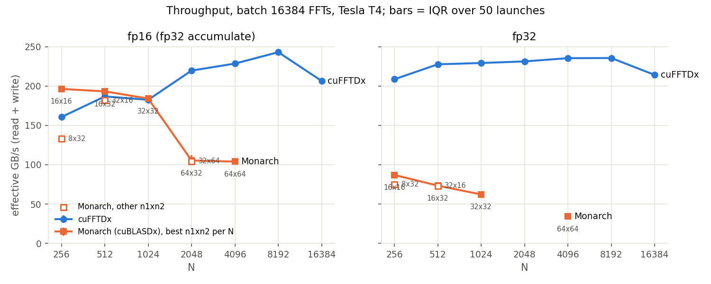
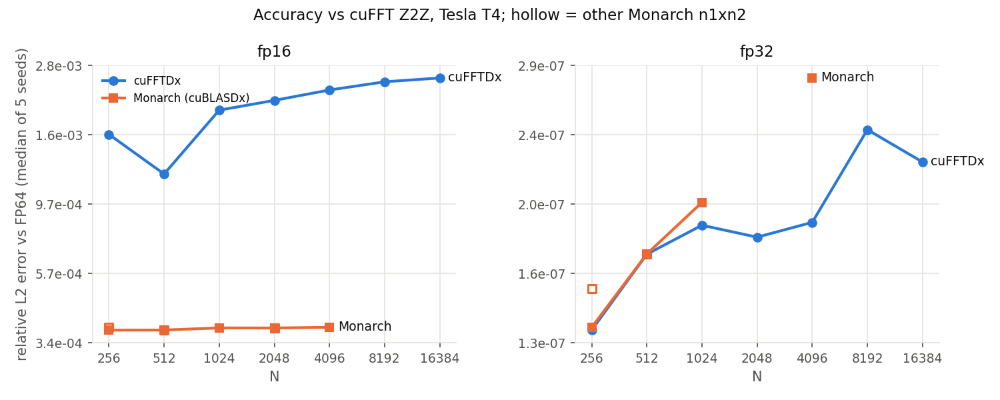

# Results: Monarch FFT on cuBLASDx vs cuFFTDx, Tesla T4

Draft. Every number below comes from one sweep file, named at the top of each
table, produced by `scripts/sweep.py` and turned into tables and figures by
`scripts/plot.py --tables`. Statements tagged *(interpretation)* are my
reading of the numbers, not measurements.

Sweep file: **pending**. The tables are filled from the first full sweep
(both binaries in one Colab session), not from the earlier per-binary runs.

## Question

For batched 1D complex FFTs computed inside one CUDA block, when does a
four-step / Monarch factorization N = n1·n2, run as two small cuBLASDx GEMMs
on tensor cores, beat cuFFTDx's radix FFT, and what does it cost in accuracy?

## Method

- **Hardware and software.** Tesla T4 (sm_75, 40 SMs) on Google Colab.
  The sweep file records the driver, CUDA, cuFFT, MathDx (26.10.0: cuFFTDx 1.8.0,
  cuBLASDx 0.8.0) and git commit on every line.
- **Transform.** Forward C2C, X[k] = Σ x[n]·exp(-2πi·nk/N), no normalization,
  out of place. N from 256 up to the largest size each implementation fits in
  one block.
- **cuFFTDx baseline.** The `Block` FFT with the library's suggested
  elements per thread and FFTs per block, following NVIDIA's examples
  (`cuda/cufftdx/block_fft.cu`). fp16 uses cuFFTDx's implicit batching
  (two FFTs per `__half2`).
- **Monarch** (`cuda/monarch/monarch_fft.cu`, derivation in `docs/derivation.md`):
  - GEMM 1 multiplies the reshaped input by F_n1.
  - Twiddles are applied in fp32 on the accumulator in registers.
  - GEMM 2 multiplies by F_n2.
  - The output is transposed through shared memory.
  - fp16 means fp16 operands with fp32 accumulation, using cuBLASDx's suggested
    shared-memory layouts (the path that emits HMMA on sm_75, see
    `docs/decisions.md`). fp32 runs on FFMA: there is no fp32 tensor-core
    instruction on sm_75.
  - 128 threads per block, max(1, 4096/N) FFTs per block, persistent grid.
- **Accuracy.**
  - Inputs ~ U(-1, 1) complex from a counter-based hash.
  - Reference: cuFFT Z2Z (FP64) on the unrounded input, so the error includes
    rounding the input to fp16/fp32.
  - Metrics: relative L2 error over 64 FFTs per seed, median over 5 seeds, and max abs error.
- **Timing.**
  - CUDA events around each launch: 5 warm-up launches, 50 timed launches, median and IQR.
  - Two batch sizes:
    - ~2^14 FFTs (throughput);
    - one block's group of FFTs on one block (latency, launch overhead included).
  - Effective GB/s = 2 · batch · N · sizeof(complex T) / time, i.e. one read and one write.
- **Tensor-core evidence.** `scripts/sass_check.sh` counts MMA, FFMA and
  HFMA2 opcodes per kernel in `cuobjdump -sass`. The counts are static: an
  unrolled-or-not K loop changes how often each one executes.

## Throughput

Table: pending sweep.

## Accuracy

Table: pending sweep.

## Speed vs accuracy

## Latency (one block)

Table: pending sweep. The two implementations put different numbers of FFTs
in a block (cuFFTDx's suggestion vs 4096/N for Monarch), so this row compares
one launch of one block each, not equal work.

## Tensor-core evidence (SASS)

Table: pending sweep. What has to hold:
- every fp16 Monarch kernel has MMA > 0;
- fp32 Monarch and all cuFFTDx kernels have MMA = 0.

The GEMM 1 of the 8×32 configuration (N = 8 columns) is expected to stay on
FMA: on sm_75 the suggested path only selects the 16×8×8 HMMA atom when the
GEMM divides a 32×16×8 warp tile (`docs/decisions.md`).

## Findings

Pending sweep.

## Limitations

- **One GPU.** T4 only (Turing, sm_75). It has fp16 HMMA but no TF32/BF16
  tensor cores, and cuBLASDx's sm_75 tuning database selects FMA for these
  shapes unless the suggested layouts are used. Nothing here says how Ampere or
  Hopper behave.
- **No profiler counters yet.**
  - Nsight Compute counters were readable on Colab in env_check, but I have not
    profiled yet.
  - Tensor-core use is shown by static SASS counts, not by tensor-pipe utilization.
  - Every statement about why something is slow is untested.
- **Shared Colab instances.** Clocks are not locked, and runs in different
  sessions differ by a few percent (compare the earlier per-binary runs in
  `results/tesla_t4/`). Only numbers from the same sweep file are compared.
- **Limited sizes.**
  - N ≤ 4096 for Monarch; fp32 2048 is skipped because 72 KB of shared memory
    exceeds the T4's opt-in limit.
  - Only power-of-two sizes and two-factor splits.
- **One input distribution.** Uniform inputs only. Errors on structured or
  large-dynamic-range signals were not measured.

## Prior work

- **FlashFFTConv** (Fu et al., ICLR 2024) runs FFT convolutions as Monarch
  decompositions on tensor cores. The Monarch idea here is theirs.
- **tcFFT** (Li, Cheng, Lin, 2021, arXiv:2104.11471): half-precision FFT on
  tensor cores.
- **Split fp32 → 2× fp16 tensor-core FFTs** (SC18 poster and follow-ups) recover
  fp32-level accuracy from fp16 tensor cores. Not attempted here.
- **NVIDIA's MathDx examples** (convolution_performance, gemm_fft, fused_gemm,
  ...): the cuFFTDx baseline follows them.

What this project adds is narrow:
- a block-level, fusable Monarch FFT inside MathDx;
- compared head-to-head against cuFFTDx rather than cuFFT;
- with the error measured against FP64 on the same inputs.
